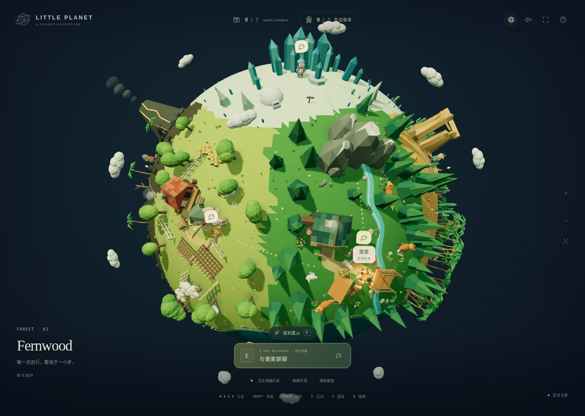

# LITTLE PLANET · 一口袋好朋友

一个用 Three.js 构建的低多边形小星球冒险。漫步七种地形，认识七位原创动物邻居，聊聊天，把友谊徽章装进口袋。

## [▶ 在线游玩](https://riki-67.github.io/little-planet/)

无需安装。支持桌面和手机，所有场景、头像、徽章、代码与图形资源均已打包在 `index.html` 内。



## 可以做什么

- 探索森林、农田、雪原、沙丘、海岸、火山与古老的观星遗迹。
- 遇见七位会眨眼、招手、转身回应你的原创邻居。
- 进行带选项的对话；邻居会记得你的第一次回答，再访时还有新的日常故事。
- 完整完成首次聊天，获得七枚不同的友谊徽章。不会因旅行、中途退出或重复聊天提前／重复发奖。
- 打开「一口袋好朋友」收藏册，查看徽章，选择下一位想拜访的邻居。
- 原有的七处景物「小小奇迹」仍然可以独立收集。

## 操作

| 操作 | 功能 |
| --- | --- |
| WASD / 方向键 | 在球面上行走 |
| Shift / 空格 | 奔跑 / 跳跃 |
| E | 与附近的邻居聊天，或与景物互动 |
| F | 同时有两种互动时，执行另一项 |
| B / M | 邻居与徽章簿 / 探索手记 |
| U / C | 全景与近景切换 / 找到自己 |
| 点击地面 / 拖拽 / 滚轮 | 自动行走 / 环绕 / 缩放 |
| 对话中 E / 空格 | 显示整句或继续对话 |
| 对话中数字键 / 选项按钮 | 选择回应 |

手机可使用虚拟摇杆、触控按钮及双指缩放。声音默认关闭，可点击右上角扬声器开启环境声与对话提示音。

## 本地存档

徽章、对话记忆及景物收集进度保存在当前浏览器的本地存储中，不上传到服务器。不同浏览器或不同网站来源的进度不一定互通。受限预览／禁用存储环境下仍可游玩，但只保留本次进度。

## 修改与更新

需要 Node.js 18 或更新版本：

```bash
npm install
npm run build
```

直接打开生成的 `index.html` 即可离线游玩。也可运行 `npm start` 启动本地预览服务器（需要 Python 3）。

修改 `src/` 后重新构建，并把源码和更新后的 `index.html` 一起提交到 `main` 分支。GitHub Pages 使用 `main` 分支根目录部署，不需要额外密钥、后端或付费服务。`.nojekyll` 用于直接发布静态网页。

详细说明、邻居名单、对话与模型文件结构见 [开发说明](docs/DEVELOPMENT.md)。

## 技术与说明

Three.js r170、程序化低多边形建模、实例化合批、球面移动、软阴影、离线分支对话与 Web Audio。角色、对白、头像与徽章为原创内容；没有运行时网络接口或第三方追踪。

Three.js 使用 MIT 许可证，见 [THREE-LICENSE.txt](THREE-LICENSE.txt)。该许可证也已嵌入游戏 HTML。
